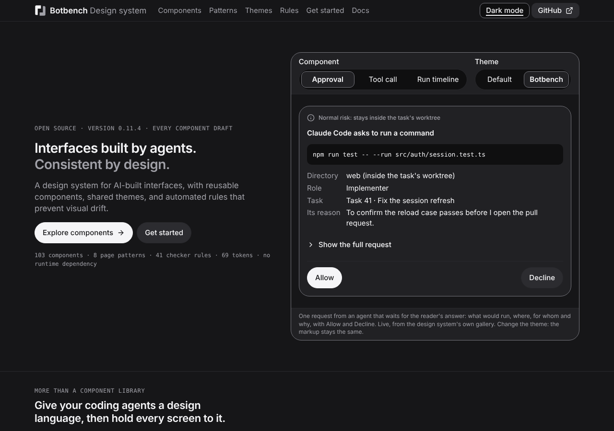

# Botbench design system showcase

The website at https://botbenchhq.github.io/design-system-showcase/. It presents the [Botbench design system](https://github.com/botbenchhq/design-system): a closed vocabulary of tokens and components for interfaces that coding agents build, and the checker that holds an app to it.

The site is static HTML, CSS and a little JavaScript, with no framework and no runtime dependency. It is built from a pinned release of the design system and stores none of it: every component, example, rule and token value on the pages is read from that release when the site is built.



## What is on it

| Page | Holds |
|---|---|
| Home | What the system is for, with live components, the checker's real output and where the project stands. |
| Components | A searchable catalogue of every component, by category. Each has its own page with every example drawn live, its guidance and its markup. |
| Patterns | The design system's page patterns, drawn live. |
| Themes | One example under each theme and mode, and the value of every token. |
| Rules and checker | How the vocabulary is enforced, a demonstration with the checker's recorded output and the rendered check run live, and all the rules. |
| Get started | Seven steps from a clone to a check in CI. |
| Docs | Links into the design system's own documentation at the pinned release. |

## Develop

You need Node 24 or later and Git.

```sh
npm ci                        # Playwright and axe, for the browser checks only
node tools/fetch-upstream.mjs # the pinned design system, into vendor/design-system
node tools/build.mjs          # writes _site/
node tools/serve.mjs          # http://localhost:4173/design-system-showcase/
```

`DESIGN_SYSTEM_DIR=../design-system node tools/fetch-upstream.mjs` reads the pinned release from a clone on your machine and uses no network.

Then check it:

```sh
npm run check:design          # the design system's static scan, over this site
node tools/check.mjs          # every link, asset and preview resolves (--online also asks outside addresses)
npx playwright install chromium
node tools/check-browser.mjs  # the pages and their interactions in a browser
```

`BROWSERS=chromium,firefox,webkit node tools/check-browser.mjs` runs the browser checks in all three. Screenshots go to `shots/`, which is not committed.

## How it is built

```
upstream.json            the release of the design system the site is built from
tools/fetch-upstream.mjs fetches that commit and syncs its dist/ into vendor/design-system
tools/lib.mjs            reads the vendored copy: components, gallery examples, categories, tokens, rules
tools/pages.mjs          the pages, as functions from that data to HTML
tools/build.mjs          writes _site/
src/site.css, site.js    the site's own layout and behaviour
src/frame.js, frame.css  what runs inside a live preview
src/demos/               the pages of the rule demonstration, each deliberately breaking a rule
```

`vendor/`, `.upstream/` and `_site/` are not committed.

**The design system is the single source.** `tools/fetch-upstream.mjs` fetches the one commit named in `upstream.json`, refuses it if its version is not the pinned one, and runs the design system's own `scripts/sync.mjs`, the same way an app takes its copy. The build publishes that copy unchanged under `ds/`, so the design system's plain gallery is at `ds/gallery/`.

**Previews are the gallery's own examples.** For each example in `ds/gallery/<component>.html` the build writes one small document, `ds/frames/<component>--<example>.html`, holding that example's element exactly as the gallery has it, with the design system's stylesheet, the gallery's script and the behaviour modules. A page shows it in an inline frame, which is what lets one page show an example under another theme, mode or width. No example markup is written in this repository.

**The shell and the catalogue are separate.** The pages' layout uses the design system's components and, for what a marketing page needs and the catalogue lacks, the classes in `src/site.css`, each declared in `design-gaps.json`. A new component upstream appears in the catalogue with no change here. A change to this site's layout cannot change how a component is drawn, because a preview loads none of the site's stylesheet.

**The checker's output is recorded, never imitated.** For each scenario in `src/demos/` the build runs the real checker and puts what it printed on the page. The build stops if the scenario that should pass fails, or one that should fail passes. The static scan needs Node, so it does not run in a visitor's browser, and the page says so. The rendered check, `check-dom.js`, does run in the browser, on the preview.

**This site passes the checker it describes.** `npm run check:design` scans every page and stylesheet with the pinned checker, and the browser checks call `dsCheckDom()` and axe on a page of each kind (ten pages, at three widths, in light and dark). CI fails on a finding.

### What stops the build

- `vendor/design-system` is missing or is not the pinned version.
- The design system no longer ships a file the site is built from.
- A component a page names, or a section of `choosing-components.md` the categories come from, is gone.
- `checker-rules.md` does not describe a rule the checker holds.
- A rule scenario does not give the result the page says it gives.

## Update the design system

1. In `upstream.json`, set `tag`, `commit` (the full commit the tag names) and `version` (the content of `dist/VERSION` at that commit).
2. Run `node tools/fetch-upstream.mjs`. The sync prints the components, patterns and rules that were added, changed or removed.
3. Run the build and the three checks above. Read the catalogue, the themes page and the rules page.
4. If the first screen of the home page changed, run `node tools/social-preview.mjs` and commit the image.
5. Commit `upstream.json`. The version in the footer, the links into the design system's repository and `version.json` follow it.

A release tag is used, with its commit beside it, so that a tag that was moved is noticed.

## Deploy

`.github/workflows/pages.yml` runs on every push to `main`: it fetches the pinned design system, builds, runs the static scan, the link check and the browser checks in Chromium, and publishes `_site/` to GitHub Pages. Its jobs can read the repository and nothing else; the deploy job alone may publish to Pages. `.github/workflows/ci.yml` runs the same checks on a pull request in Chromium, Firefox and WebKit, and asks every outside address.

One setting is made by hand, once: in the repository's **Settings → Pages**, set **Source** to **GitHub Actions**.

Every link between pages is relative, so the site works under any path. Only `404.html`, which GitHub Pages serves at any depth, uses the site's path, from `SITE_BASE` (default `/design-system-showcase/`). To move the site to another address, change `SITE.url` in `tools/pages.mjs`, `SITE_BASE` in the workflow, and the paths in `robots.txt` written by `tools/build.mjs`.

## What it claims

- Every count on the pages (components, patterns, rules, tokens, examples, don'ts) is counted from the pinned release.
- Statements about status and testing repeat the design system's README: every component is draft, one app uses it, and nothing has been tried on a real iPhone or with a screen reader.
- The site sets no cookies and counts no visits. It keeps the chosen mode and theme in the browser's local storage.

## Licence

Apache License 2.0. See [`LICENSE`](LICENSE) and [`NOTICE`](NOTICE).
